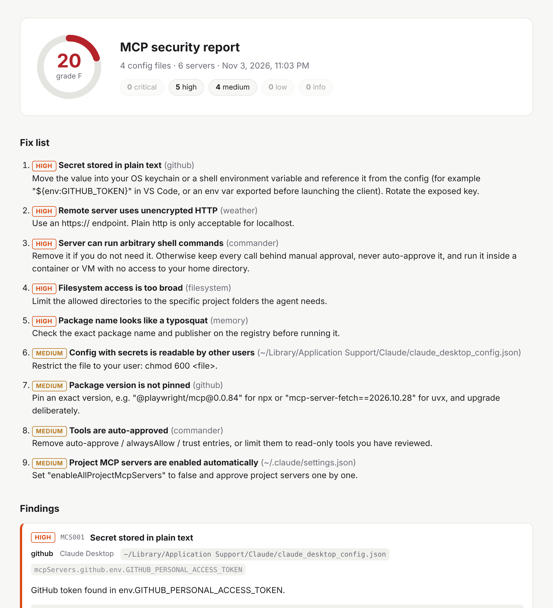

# mcpsafe

**A one-command security audit for your MCP servers and AI agent configs.**

```bash
npx mcpsafe
```

MCP servers run with your permissions, see your files and talk to your model. Most people install them by pasting a JSON snippet from a README. `mcpsafe` reads the configs of every AI client on your machine and tells you, in plain language, which of those setups are risky and how to fix them.


- **Zero install, zero dependencies.** Plain Node.js 18+. Static scans never touch the network.
- **Finds every config.** Claude Desktop, Claude Code, Cursor, VS Code, Windsurf, Cline, Roo Code and Gemini CLI, on macOS, Linux and Windows. Comments and trailing commas are fine.
- **18 checks** for secrets, supply chain, over-privileged tools, auto-approval and tool poisoning.
- **A score and a fix list**, not just a wall of warnings. Secrets are always masked.
- **Terminal, HTML, JSON, SARIF and Markdown** output.
- **GitHub Action** that catches risky `.mcp.json` / `.cursor/mcp.json` / `.vscode/mcp.json` changes in pull requests.

## What it checks

| ID | Severity | Check |
|---|---|---|
| MCS001 | high (critical in repo files) | Secret stored in plain text: API keys, tokens, `Bearer` headers, DB URLs with passwords |
| MCS002 | medium | Config file with secrets is readable by other users |
| MCS003 | medium | `npx` / `uvx` / `pipx` package not pinned to an exact version |
| MCS004 | medium | Docker image without a tag, or `:latest` |
| MCS005 | high | Remote server over plain `http://` (not localhost) |
| MCS006 | high | Token or key in the server URL query string |
| MCS007 | high | Server exposes shell / command execution |
| MCS008 | high | Filesystem access to `/`, `~`, `C:\` or a whole home folder (also Docker mounts) |
| MCS009 | high | Container started with `--privileged`, host network/PID, extra capabilities or the Docker socket |
| MCS010 | critical | Launch command pipes a downloaded script into a shell (`curl … \| sh`) |
| MCS011 | medium / high | Tools auto-approved: `autoApprove`, `alwaysAllow`, `trust: true`, `mcp__server` allow rules, `bypassPermissions`, `chat.tools.autoApprove` |
| MCS012 | medium | Claude Code `enableAllProjectMcpServers` (any cloned repo can start servers) |
| MCS013 | high | Package name is a lookalike of a popular MCP server (typosquat) |
| MCS014 | medium | Server runs from `/tmp`, `Downloads` or another temp folder |
| MCS015 | high | Invisible Unicode (zero-width, bidi override, tag characters) in a config |
| MCS016 | critical | Hidden instructions in tool or parameter descriptions (tool poisoning) |
| MCS017 | medium | Tool name collisions, or one server's descriptions giving orders about another server's tools |
| MCS018 | medium | Installed straight from a git repo or URL without a pinned commit |

Run `npx mcpsafe --rules` to list them, and see [`src/rules.js`](src/rules.js) for the reasoning and fix for each.

## Usage

```bash
npx mcpsafe                       # scan your user configs + the current folder
npx mcpsafe ./my-repo             # also scan a project folder (recursively)
npx mcpsafe --no-home .           # only the project, ignore your machine
npx mcpsafe --html                # also write mcpsafe-report.html
npx mcpsafe --json > report.json  # machine-readable
npx mcpsafe --fail-on high        # exit 1 if anything high or critical is found
```

| Option | What it does |
|---|---|
| `--connect` | Starts each configured server, lists its tools and checks the descriptions (MCS016, MCS017). Off by default because it runs the servers. |
| `--tools <file>` | Checks a saved `tools/list` response instead of connecting. |
| `--html [file]` | Writes a self-contained HTML report. |
| `--sarif <file>` | Writes SARIF 2.1.0 for GitHub code scanning. |
| `--markdown <file>` | Appends a Markdown summary (used for CI job summaries). |
| `--json` | Prints JSON instead of the terminal report. |
| `--fail-on <severity>` | Exit code 1 if any finding is at or above `critical`, `high`, `medium` or `low`. |
| `--min-score <n>` | Exit code 1 if the score is below `n`. |
| `--ignore <ids>` | Skip rules, e.g. `--ignore MCS003,MCS004`. |
| `--home <dir>` | Use a different home folder. |
| `-v, --verbose` | Show masked evidence for each finding. |

### Checking tool descriptions

A malicious or compromised server can hide instructions inside a tool description that the model reads but you never see. With `--connect`, mcpsafe speaks MCP to each server (stdio and Streamable HTTP), pages through `tools/list`, and inspects every tool and parameter description:

```text
$ npx mcpsafe --connect

  CRITICAL  MCS016  Hidden instructions in tool description
            server "calculator" · Claude Code · .mcp.json
            Tool "multiply": hidden tag, asks the model to hide something from the user, pre-call
            side task, references sensitive files, smuggles data through a parameter.
```

Only use `--connect` on a machine where it is acceptable to start those servers.

### HTML report

`npx mcpsafe --html` writes a single, offline HTML file with the score, a prioritized fix list, and every finding with why it matters. It follows your light/dark setting.



## Scoring

Every scan starts at 100. Each finding subtracts points by severity (critical 25, high 12, medium 5, low 2). Repeats of the same rule count half as much each time, so one noisy rule cannot sink the score alone. Grades: A ≥ 90, B ≥ 80, C ≥ 70, D ≥ 60, F below that.

The score is a guide for prioritizing, not a certificate. Static checks cannot prove a server is safe.

## GitHub Action

Scan the MCP configs committed to a repository on every pull request:

```yaml
name: MCP security
on: [push, pull_request]

jobs:
  mcpsafe:
    runs-on: ubuntu-latest
    permissions:
      contents: read
      security-events: write   # only needed for the SARIF upload
    steps:
      - uses: actions/checkout@v4
      - uses: r0ottrek/mcpsafe@v1
        with:
          fail-on: high          # critical | high | medium | low | none
      - uses: github/codeql-action/upload-sarif@v3
        if: always()
        with:
          sarif_file: mcpsafe.sarif
```

The action annotates the offending config lines on the pull request, writes a summary table to the job page, and exposes `score`, `grade` and `findings` as outputs. Inputs: `path`, `fail-on`, `min-score`, `ignore`, `sarif`, `html`.

## Use it as a library

```js
import { scan } from 'mcpsafe';

const result = await scan({ paths: ['.'], includeHome: false });
console.log(result.score, result.findings);
```

## Development

```bash
git clone https://github.com/r0ottrek/mcpsafe && cd mcpsafe
npm test                 # node:test, no dependencies
npm run demo             # scan the deliberately risky example in examples/risky-setup
```

`examples/risky-setup` triggers most rules; `examples/safe-setup` shows the same servers configured safely and scores 100. The fake credentials in the examples are not real.

Ideas and new checks are welcome. A good check is specific, explains why it matters, and comes with a fix.

## License

MIT
