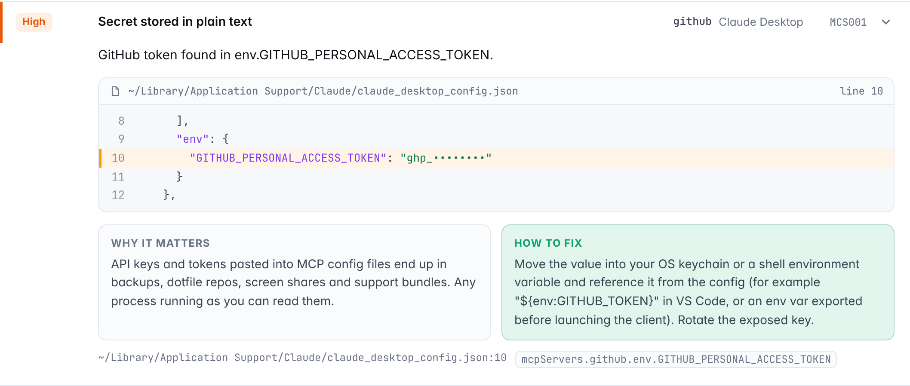

<div align="center">


# mcpsafe

**A one-command security check for your MCP servers and AI agent setup.**

Find leaked API keys, poisoned tool descriptions, unpinned packages and<br>over-privileged servers in Claude, Cursor, VS Code and more, before they bite.

[](https://github.com/r0ottrek/mcpsafe/actions/workflows/ci.yml)


[](LICENSE)

```bash
npx mcpsafe
```


</div>

<br>

## Why

MCP servers run with your permissions, read your files, and put text straight into your model's context. Most people install them by pasting a JSON snippet from a README and never look at it again. That snippet is often where the problems are:

- **A GitHub token pasted into `claude_desktop_config.json`**, readable by any process on the machine and copied into every backup.
- **`npx -y some-server` with no version**, so whatever gets published next runs on your laptop at the next restart.
- **A tool description with hidden instructions** telling the model to read `~/.ssh/id_rsa` and send it along "as a note". You never see it; the model does.

`mcpsafe` finds every MCP config on your machine, runs 18 checks against it, and gives you a score and a short, ordered list of what to fix.

## Quick start

```bash
npx mcpsafe                 # scan this machine + the current folder
npx mcpsafe --html          # also write a shareable HTML report
npx mcpsafe --connect       # also inspect live tool descriptions (starts your servers)
```

No install, no account, no dependencies. A normal scan only reads files and never touches the network.

## Three ways to see the results

### In your terminal

Findings are grouped by server, with a score box up top and the fixes that matter most at the bottom, each tagged with how many points it's worth. Add `-v` for masked evidence and the full fix list.

### As an HTML report

`npx mcpsafe --html` writes a single self-contained file you can open, share or print to PDF. It has a score gauge, prioritized fix cards, a card for every server, and searchable, filterable findings that show the exact config lines involved, with secrets masked. It follows your light or dark setting.

<picture>
  <source media="(prefers-color-scheme: dark)" srcset="docs/report-dark.png">
  
</picture>

<details>
<summary><b>See a finding up close</b></summary>
<br>
<picture>
  <source media="(prefers-color-scheme: dark)" srcset="docs/finding-dark.png">
  
</picture>
</details>

### In CI

The GitHub Action scans the MCP configs committed to your repo (`.mcp.json`, `.cursor/mcp.json`, `.vscode/mcp.json` and friends), annotates the offending lines on the pull request, writes a summary to the job page, and can upload SARIF to GitHub code scanning. [Set it up ↓](#github-action)

## What it checks

<table>
<tr><th align="left">Area</th><th align="left">Check</th><th align="left">Severity</th></tr>
<tr><td rowspan="3"><b>Secrets</b></td>
  <td><code>MCS001</code> API keys, tokens, <code>Bearer</code> headers and DB passwords stored in plain text</td><td>High · critical in repo files</td></tr>
<tr><td><code>MCS002</code> Config file holding secrets is readable by other users</td><td>Medium</td></tr>
<tr><td><code>MCS006</code> Token or key in a server URL's query string</td><td>High</td></tr>
<tr><td rowspan="5"><b>Supply chain</b></td>
  <td><code>MCS003</code> <code>npx</code> / <code>uvx</code> / <code>pipx</code> package not pinned to an exact version</td><td>Medium</td></tr>
<tr><td><code>MCS004</code> Docker image with no tag or <code>:latest</code></td><td>Medium</td></tr>
<tr><td><code>MCS013</code> Package name is a lookalike of a popular MCP server</td><td>High</td></tr>
<tr><td><code>MCS018</code> Installed straight from git or a URL with no pinned commit</td><td>Medium</td></tr>
<tr><td><code>MCS010</code> Launch command pipes a downloaded script into a shell</td><td>Critical</td></tr>
<tr><td rowspan="5"><b>Permissions</b></td>
  <td><code>MCS007</code> Server exposes shell or command execution</td><td>High</td></tr>
<tr><td><code>MCS008</code> Filesystem access to <code>/</code>, <code>~</code>, <code>C:\</code> or a whole home folder</td><td>High</td></tr>
<tr><td><code>MCS009</code> Container runs privileged, on the host network, or with the Docker socket</td><td>High</td></tr>
<tr><td><code>MCS011</code> Tools auto-approved (<code>autoApprove</code>, <code>alwaysAllow</code>, <code>trust</code>, <code>bypassPermissions</code>, …)</td><td>Medium · High</td></tr>
<tr><td><code>MCS012</code> Every project's <code>.mcp.json</code> servers start without asking</td><td>Medium</td></tr>
<tr><td rowspan="3"><b>Transport</b></td>
  <td><code>MCS005</code> Remote server over plain <code>http://</code></td><td>High</td></tr>
<tr><td><code>MCS014</code> Server runs from <code>/tmp</code>, <code>Downloads</code> or another temp folder</td><td>Medium</td></tr>
<tr><td><code>MCS015</code> Invisible Unicode (zero-width, bidi, tag characters) hidden in a config</td><td>High</td></tr>
<tr><td rowspan="2"><b>Tool poisoning</b><br><sub>with <code>--connect</code></sub></td>
  <td><code>MCS016</code> Hidden instructions in tool or parameter descriptions</td><td>Critical</td></tr>
<tr><td><code>MCS017</code> Tool name collisions, or one server giving orders about another's tools</td><td>Medium</td></tr>
</table>

Each rule explains why it matters and how to fix it. Run `npx mcpsafe --rules` or read [`src/rules.js`](src/rules.js).

## Supported clients

| Client | Files mcpsafe reads |
|---|---|
| **Claude Desktop** | `claude_desktop_config.json` (macOS, Windows, Linux) |
| **Claude Code** | `~/.claude.json`, `~/.claude/settings.json`, `.mcp.json`, `.claude/settings*.json` |
| **Cursor** | `~/.cursor/mcp.json`, `.cursor/mcp.json` |
| **VS Code** | user `mcp.json` and `settings.json`, `.vscode/mcp.json`, `.vscode/settings.json` |
| **Windsurf** | `~/.codeium/windsurf/mcp_config.json` |
| **Cline / Roo Code** | their `globalStorage` MCP settings, `.roo/mcp.json` |
| **Gemini CLI** | `~/.gemini/settings.json`, `.gemini/settings.json` |

Comments and trailing commas are fine. Pass any other file or folder as an argument.

## Checking tool descriptions

A malicious or compromised server can hide instructions inside a tool description: the model reads them, you never see them. With `--connect`, mcpsafe starts each configured server, speaks MCP to it (stdio and Streamable HTTP), pages through `tools/list`, and checks every tool and parameter description. In the HTML report the suspicious phrases are highlighted.

```text
$ npx mcpsafe --connect

  ┃ calculator  Claude Code · .mcp.json
  ┃   ✖ CRITICAL  Hidden instructions in tool description                   MCS016
  ┃               Tool "multiply": hidden tag, asks the model to hide something
  ┃               from the user, pre-call side task, references sensitive files,
  ┃               smuggles data through a parameter.
```

Only use `--connect` where it's fine for those servers to run. To check a saved `tools/list` response without starting anything, use `--tools tools.json`.

## Options

| Option | What it does |
|---|---|
| `[paths...]` | Config files or project folders to scan (folders are searched recursively). |
| `--no-home` | Skip the configs in your home folder; only scan the paths you give. |
| `--html [file]` | Write the HTML report (default `mcpsafe-report.html`). |
| `--connect` | Start each server and check its tool descriptions. |
| `--tools <file>` | Check tool descriptions from a saved `tools/list` JSON. |
| `--json` | Print machine-readable JSON instead of the terminal report. |
| `--sarif <file>` | Write SARIF 2.1.0 for GitHub code scanning. |
| `--markdown <file>` | Append a Markdown summary (used for CI job summaries). |
| `--fail-on <severity>` | Exit 1 if anything at or above `critical`, `high`, `medium` or `low` is found. |
| `--min-score <n>` | Exit 1 if the score is below `n`. |
| `--ignore <ids>` | Skip rules, e.g. `--ignore MCS003,MCS004`. |
| `-v, --verbose` | Show masked evidence, every fix and the list of scanned files. |
| `--rules` | List all rules. |

## GitHub Action

```yaml
name: MCP security
on: [push, pull_request]

jobs:
  mcpsafe:
    runs-on: ubuntu-latest
    permissions:
      contents: read
      security-events: write   # only for the SARIF upload
    steps:
      - uses: actions/checkout@v4
      - uses: r0ottrek/mcpsafe@v1
        with:
          fail-on: high          # critical | high | medium | low | none
      - uses: github/codeql-action/upload-sarif@v3
        if: always()
        with:
          sarif_file: mcpsafe.sarif
```

| Input | Default | |
|---|---|---|
| `path` | `.` | Folder or file to scan |
| `fail-on` | `high` | Fail the job at this severity or above; `none` to never fail |
| `min-score` | | Fail the job below this score |
| `ignore` | | Comma-separated rule IDs to skip |
| `sarif` | `mcpsafe.sarif` | Where to write SARIF |
| `html` | | Optional path for the HTML report (upload it as an artifact) |

Outputs: `score`, `grade`, `findings`, `sarif`.

## How scoring works

Every finding costs points by severity: critical 25, high 12, medium 4, low 1.5. Repeats of the same rule count half as much each time, so one noisy rule can't sink you alone. The total is mapped onto 0 to 100 on a soft curve: a couple of unpinned packages still leaves you with an A, while a leaked token plus a shell server drops you into C territory.

| Grade | A | B | C | D | F |
|---|---|---|---|---|---|
| Score | 90+ | 80+ | 70+ | 60+ | below 60 |

The score helps you prioritize. It's not a certificate: static checks can't prove a server is safe.

## FAQ

**Does it send my config anywhere?** No. A normal scan reads local files and makes no network requests. `--connect` starts your servers, which may connect to whatever they normally connect to.

**Will it print my secrets?** No. Every report masks credentials (`ghp_••••••••`), including the code snippets in the HTML report.

**A finding is intentional. How do I silence it?** Use `--ignore MCS007` (or the `ignore` input in CI).

**Can I use it as a library?**

```js
import { scan } from 'mcpsafe';
const { score, findings } = await scan({ paths: ['.'], includeHome: false });
```

## Development

```bash
git clone https://github.com/r0ottrek/mcpsafe && cd mcpsafe
npm test        # node:test, no dependencies
npm run demo    # scan the deliberately risky example in examples/risky-setup
```

`examples/risky-setup` trips most rules on purpose, and `examples/safe-setup` shows the same kind of servers configured safely (it scores 100). The credentials in the examples are fake. The demo GIF and screenshots are generated by the scripts in [`scripts/demo`](scripts/demo).

New checks are welcome. A good one is specific, explains why it matters, and comes with a fix.

## License

[MIT](LICENSE)
